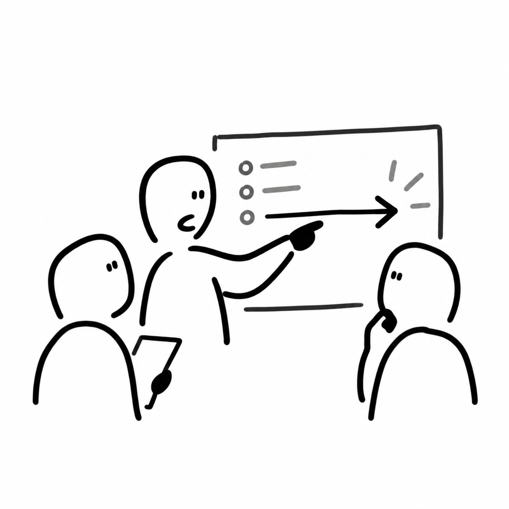
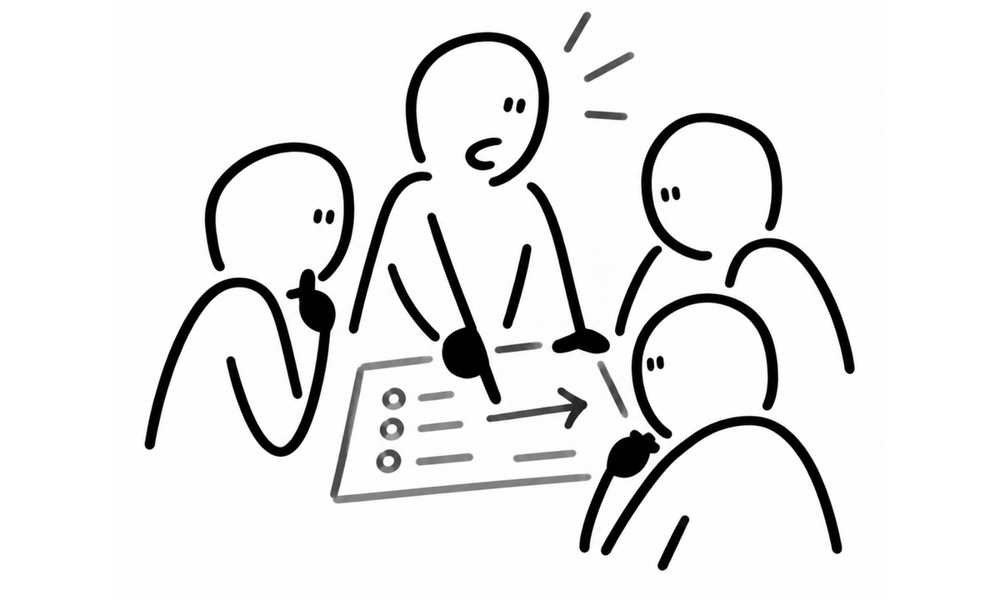
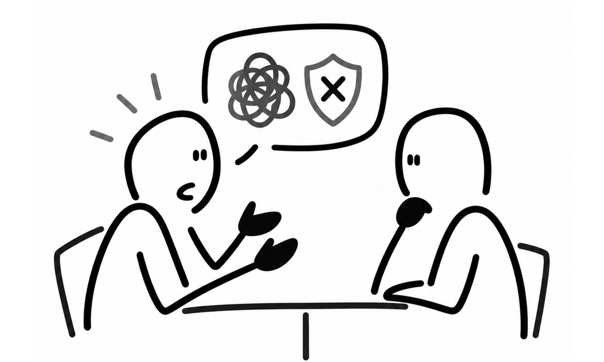
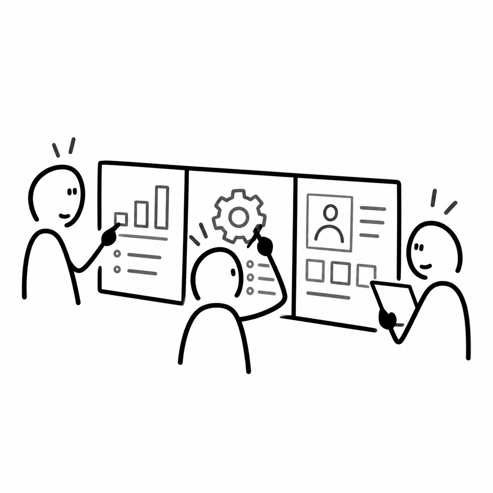
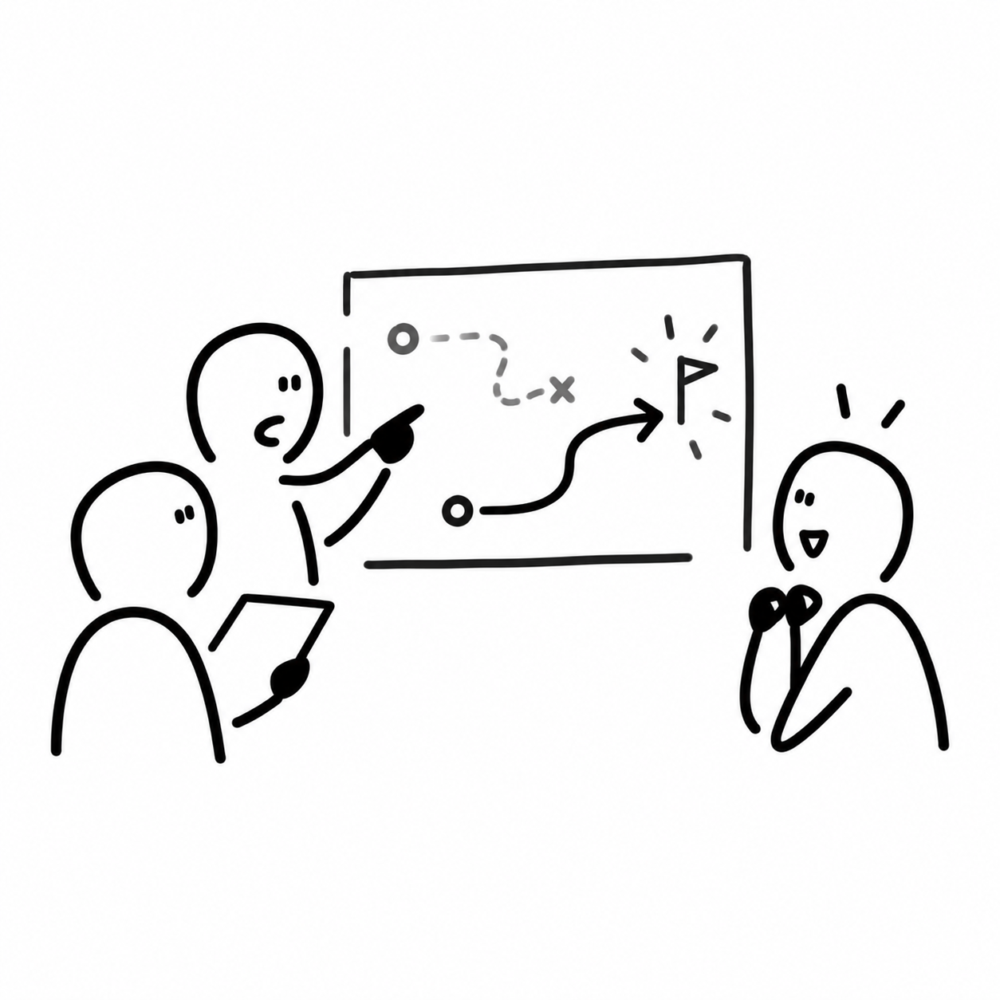
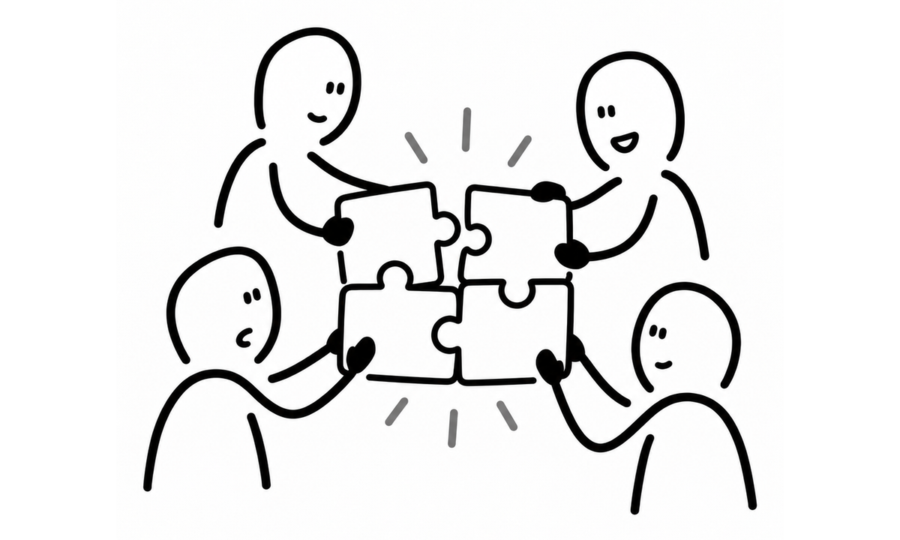

# 모든 것을 이해하고 통제하려 했던 내가, 팀원을 신뢰하기까지

### 이 경험을 정리하는 이유

추후 모의 면접이나 실제 면접에서 저의 단점을 이야기할 때, 모든 것을 이해하고 통제하려는 성향에 대해 이야기해 보려고 합니다.

이러한 성향이 실제 팀 프로젝트에서 어떻게 드러났고, 어떤 문제를 만들었으며, 이를 극복하는 과정에서 팀원들과의 협업 방식이 어떻게 달라졌는지 이야기하고 싶습니다.

이 경험이 저의 단점과 성장을 보여주는 사례로 적절한지 궁금합니다.

---

저는 프로덕트와 팀이 앞으로 나아가기 위해서는 **지향하는 방향이 매우 뾰족하고 명확해서 일관될 수 있어야 한다**고 생각합니다.

이 믿음은 지금도 변하지 않았지만, 파이널 프로젝트를 진행하던 당시에는 그 믿음이 지나치게 강했고, 어느 순간 본래의 의미에서 벗어나 잘못된 방향으로 변질되었던 것 같습니다.

당시 저는 프로덕트의 방향성을 더욱 뾰족하게 만들기 위해서는 팀원 모두가 같은 생각을 해야 한다고 믿었습니다. 그러기 위해서는 팀원 한 명 한 명의 의도와 행동을 제가 모두 이해하고 있어야 한다고 생각했습니다.

**마치 한명의 지휘자가 전체적인 방향과 흐름을 설계하고 연주하는 오케스트라처럼, 팀원들이 그에 맞춰 각자의 역할을 수행하는 것이 이상적인 협업이라고 믿었습니다.**

그래야 프로덕트의 방향성이 흔들리지 않고, 일관된 방향으로 발전하여 좋은 결과물을 만들 수 있다고 생각했습니다. 더 현실적으로는 취업 시장에서도 이렇게 일관된 목표를 향해 협업한 경험이 경쟁력 있게 평가받을 것이라고 믿었습니다.

좋게 표현하면 프로덕트에 대한 관심과 책임감이 강했던 것이지만, 지금 돌이켜보면 **저는 팀의 방향을 함께 만들어가는 사람이 아니라, 팀의 모든 것을 통제하려는 사람인 통제광에 가까웠습니다.**

팀원이 실수하면 그 사람에 대한 신뢰가 쉽게 흔들렸고, 문제를 스스로 해결할 기회를 주기보다 제가 판단한 해결 방법을 지시하곤 했습니다.

또한 하나의 기능을 개발하더라도 모든 팀원이 모여 방향성을 함께 논의해야 한다고 생각했습니다.&#x20;

그래야 제가 생각하는 '옳은 방향'으로 나아가기 위해서는 이러한 과정이 반드시 필요하다고 믿었기 때문입니다.

당시에는 이것이 책임감 있는 행동이라고 생각했습니다.

이러한 사고방식에 처음 의문을 갖게 된 계기는 멘토인 케빈의 제안이었습니다.

케빈은 백엔드 개발자들이 두 명이 기능을 나누어 개발하는 방식을 제안했습니다.

그 방식으로 개발을 진행하면서 저는 하나의 기능을 온전히 맡게 되었고, 자연스럽게 다른 기능의 개발 과정에는 깊이 관여하기 어려워졌습니다.

처음에는 별문제가 없을 것이라고 생각했습니다.

그런데 일주일 정도 지나자 점점 불안해지기 시작했습니다. 다른 기능이 어떤 방향으로 개발되고 있는지 충분히 알지 못한다는 사실이 불편했고, 팀이 잘못된 방향으로 나아가고 있다는 느낌까지 들었습니다.

돌이켜보면 이상한 일이었습니다.

실제로 문제가 발생한 것도 아니었고, 팀원들의 역량이 부족하다는 근거가 있었던 것도 아니었습니다.

**그저 제가 덜 관여하고 있다는 이유만으로 팀이 잘못된 방향으로 나아가고 있다고 판단했던 것입니다.**

그때 처음으로 제가 팀원들을 온전히 신뢰하지 못하고 있다는 사실을 자각했습니다.

팀원들의 판단보다 제 판단을 더 신뢰했고, 제가 관여해야만 더 좋은 결과를 만들 수 있다고 생각했던 것 같습니다.

이러한 제 모습이 스스로도 이상하게 느껴져 케빈에게 솔직하게 털어놓았고,
미팅에서 케빈은 제 생각을 바꾸기 위해 실제 서비스 사례를 예시로 들어 설명해 주었습니다.

하나의 서비스에는 수많은 기능이 존재하고, 각 기능을 담당하는 팀과 개발자가 있습니다.

예를 들어 주문 기능을 담당하는 개발자는 서비스의 모든 기능을 이해하고 통제하려 하기보다, 자신이 담당하는 주문 도메인에 깊이 집중합니다.

서비스가 추구하는 공동의 목표를 이해하되, 그 목표를 달성하기 위해 자신에게 주어진 영역을 깊이 고민하고 발전시키는 것입니다.

그 과정에서 수많은 문제를 마주하고, 스스로 고민하고, 의사결정을 내리면서 누구보다 해당 도메인을 깊이 이해하는 개발자로 성장합니다.

이 이야기를 들으며 그동안 제가 놓치고 있던 것을 깨달았습니다.

**좋은 개발자가 된다는 것은 모든 기능을 이해하고 모든 의사결정에 관여하는 것이 아니라, 공동의 목표를 이해하고 자신이 맡은 영역에서 깊이 사고하며 최선의 결과를 만들어내는 사람일 수도 있다는 것이었습니다.**

그리고 좋은 팀이란 모든 구성원이 동일한 생각을 하는 조직이 아니라, 공동의 목표 아래 각자의 전문성과 판단을 발휘할 수 있는 조직일지도 모른다고 생각했습니다.

물론 이러한 사실을 깨달았다고 해서 하루아침에 팀원들을 온전히 신뢰할 수 있었던 것은 아닙니다.

여전히 다른 기능의 개발 과정이 궁금했고, 제가 생각하는 방향과 다르게 진행되는 것을 보면 개입하고 싶은 마음이 들었습니다.

그래서 우선 일주일 동안은 불안하더라도 팀원들에게 각자의 기능을 온전히 맡겨보기로 했습니다.

중간중간 의견을 제시하고 싶은 순간이 많았지만, 그것이 정말 공동의 목표에 영향을 미치는 중요한 문제인지, 아니면 단순히 제 생각과 다르기 때문에 불편한 것인지를 구분하려고 노력했습니다.

명확한 문제가 없다면 팀원들의 판단을 존중하고, 스스로 고민하며 결정할 수 있도록 기다렸습니다.

일주일이 지난 뒤 결과를 확인했을 때, 개발은 제가 처음 생각했던 것과는 다른 방향으로 진행되어 있었습니다.

그런데 그 방향 역시 충분히 합리적이었고, 오히려 제가 생각하지 못했던 좋은 접근법이었습니다.

제가 관여하지 않았기 때문에 잘못된 결과가 나온 것이 아니라, 제가 관여하지 않았기에 발견할 수 있었던 또 다른 좋은 방법이 존재했던 것입니다.

이 경험은 제게 생각보다 큰 깨달음을 주었습니다.

저는 그동안 팀의 모든 생각을 하나로 모아야 좋은 결과를 만들 수 있다고 믿었습니다. 하지만 실제로는 서로 다른 생각과 관점이 존재하기 때문에 혼자서는 발견하지 못했을 해결책을 찾아낼 수 있었습니다.

예전의 저는 좋은 팀이란 하나의 생각을 공유하고, 같은 방향으로 일사불란하게 움직이는 조직이라고 생각했습니다.

하지만 지금은 조금 다르게 생각합니다.

**"어쩌면 팀은 모든 구성원이 똑같이 생각하지 않기 때문에 더욱 뛰어난 결과를 만들어낼 수 있는 것이 아닐까?"**

지금은 **같은 목표를 바라보되, 그 목표에 도달하는 과정에서는 각자의 생각과 판단이 존중받는 팀이 더 강한 팀**이라고 생각합니다.

팀원 수만큼 서로 다른 경험과 관점이 존재하기 때문에, 한 사람이 모든 것을 이해하고 통제할 때보다 더 다양한 가능성을 발견할 수 있습니다.

그 차이가 때로는 갈등을 만들기도 하지만, 동시에 혼자서는 상상하지 못했을 새로운 해결책을 발견하게 만들기도 합니다.

제가 모든 것을 이해할 필요는 없었습니다.
모든 의사결정에 관여할 필요도 없었습니다.
정말 중요했던 것은 우리가 같은 목표를 향해 나아가고 있는지 확인하는 것, 그리고 각자의 영역에서 최선의 판단을 내릴 수 있도록 서로 신뢰하는 것이었습니다.

물론 신뢰가 무관심이나 방임을 의미하는 것은 아닙니다. 공동의 목표와 중요한 의사결정 기준은 함께 공유하되, 그 목표를 달성하는 구체적인 방법까지 모두 동일할 필요는 없다는 의미입니다.

이번 경험을 통해 **신뢰란 상대방이 반드시 제가 예상한 방식으로 행동할 것이라고 믿는 것이 아니라, 저와 다른 방식으로 접근하더라도 좋은 결과를 만들어 낼 수 있다고 인정하는 태도**라는 것을 느끼게 되었습니다.

여전히 저는 프로덕트의 방향성이 명확해야 한다고 생각합니다. 다만 이제는 그 방향성을 유지하는 방법이 모든 의사결정에 관여하는 것이라고 생각하지 않습니다.

하지만 이제는 제가 모든 것을 통제하지 않더라도, 아니 오히려 통제하지 않기 때문에 팀이 더 좋은 결과를 만들어낼 수 있다는 것을 이해하게 되었습니다.

**좋은 팀을 만드는 것은 한 사람의 확신이 아니라, 서로 다른 사람들의 판단을 신뢰하고 그 가능성을 연결하는 일이라고 생각합니다.**
